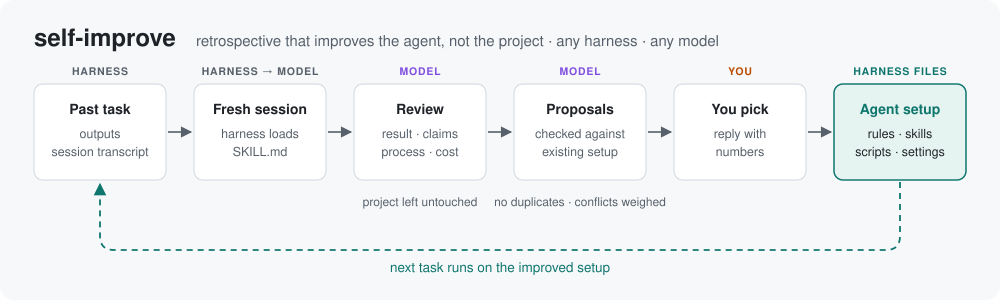

# self-improve



A skill for AI coding agents. It reviews how a finished task was handled and proposes
changes to the agent's own setup (rules, skills, scripts, settings) so later tasks go
better. Its proposals target the agent's setup, not the project it reviews. Each review
also looks for rules to cut, so the setup does not grow without limit.

Written for any harness that loads `SKILL.md` skills (goose, Claude Code, Codex, Qwen Code,
others) and any model. Tested with goose and a local model: applied proposals changed
the agent's later behaviour, but one review does not catch everything; a second run finds more.

## What it does

Run from a fresh session that did not do the work:

1. States the task's goal before reading any notes from the session that did it.
2. Checks the result directly: does it work, is it complete, do its key claims hold?
   Flags checks that were circular (verified using the same data that produced the result).
3. Works out the shortest path to the result and compares it with the path taken.
4. Reads the session transcript: where time and tokens went, repeated retries,
   abandoned work, wrong assumptions, what went well.
5. Checks whether the existing rules were followed at the moments they applied.
6. Keeps lessons that would apply to other projects and maps each to a gap in the
   agent's setup: rules file, skill, script, or setting.
7. Compares every proposal with the existing setup and with the other proposals.
   Duplicates are dropped, overlaps extend existing text, contradictions are weighed
   and resolved (replace, scope, or drop).
8. Reports, then waits for the user to pick proposals.

The skill instructs the model not to modify the project or apply changes unasked, but a
model can ignore instructions. Run it on version-controlled or backed-up work, and read
each proposal before approving it.

## Keeping rules lean

Always-on rules are read on every turn, and a long rules file dilutes each line in it.
Without limits, frequent reviews would only add rules. So every review also:

- **Holds a budget.** The rules file states its own limit, e.g. `# rules budget: 100 lines`.
  If there is none, the review proposes one and you pick the number. Larger models
  handle longer rules; small local models follow fewer lines well. At or over budget,
  every added line must remove or merge at least one.
- **Escalates ignored rules.** A rule that was ignored can be reworded once. Ignored
  again, it is replaced by a script or check that enforces it, or removed.
- **Prefers tools to text.** A script that makes the right step easy beats another
  sentence asking for it.
- **Date-tags rules** as `(YYYY-MM, task)` when it adds them, so later reviews can spot
  stale ones.
- **Proposes removals**: redundant, wrong, stale or repeatedly ignored lines.

## Output

```
Outcome: goal met / partly met / not met
Process: efficient / slow / wasteful, and where the cost went

What went wrong      evidence only, with where it happened
What went well       to keep
Setup gaps           the missing rule, procedure, tool or setting

Proposed changes (reply with the numbers to apply)
1. [rules | skill | script | setting] title, target harness
   Prevents:  the gap, and what it would have saved
   Change:    exact file and exact text
   Fits with: none / extends X / replaces X / conflicts with X, and the recommendation
   Cost/risk: per-turn context cost, what could go wrong

Proposed removals    lines to cut or merge, and why
Rules budget         lines used / budget, before and after
```

Reply with the numbers to apply (e.g. "1, 3 and R1"). The agent backs up each file,
applies the changes, checks that no rules now contradict each other, and reports how
to undo.

## Install

Clone into your harness's skills folder, for example:

```bash
git clone https://github.com/DMS3tv/self-improve ~/.agents/skills/self-improve   # goose
git clone https://github.com/DMS3tv/self-improve ~/.claude/skills/self-improve   # Claude Code
```

Using several harnesses: clone once and symlink it into the others' skills folders.
`references/harnesses.md` lists the usual folders per harness.

## Use

In a new session, ask for one of:

- **Review a task**: "use the self-improve skill on <task / folder / session>".
  Add a focus if you have one: "...focus on why it took so long".
- **Prune the rules**: "use the self-improve skill as a pruning pass on my rules file,
  using my recent sessions as evidence". Sets the budget, tags existing rules, and
  proposes cuts and merges. Worth doing before applying a batch of new proposals, and
  now and then as the rules file grows.

goose: `goose/self-improve.yaml` is a recipe that starts the fresh session for you.
Copy it into `~/.agents/recipes/` (a symlink is not picked up), then:

```bash
# review a task
goose run --recipe self-improve --params target="what to review" --params focus="why it was slow"

# prune the rules
goose run --recipe self-improve --params target="~/.config/goose/.goosehints, recent sessions as evidence" --params focus="pruning pass"
```

To apply, reply in the same session with the numbers (with goose:
`goose run --resume --session-id <id> -t "apply 1, 3 and R1"`).

Tips:
- Reviews vary between runs. For a task that went badly, a second run often finds more.
- Point it at the session transcript, not only the output: most findings come from how
  the work was done.

## Files

| File | Purpose |
|---|---|
| `SKILL.md` | The procedure the agent follows |
| `references/harnesses.md` | Where each harness keeps rules, skills, settings and transcripts |
| `scripts/session_log.py` | Condenses a session transcript (any JSONL, or goose's database) and prints its cost |
| `goose/self-improve.yaml` | Optional goose recipe |

`session_log.py` needs only Python 3.

## License

MIT. See `LICENSE`.
